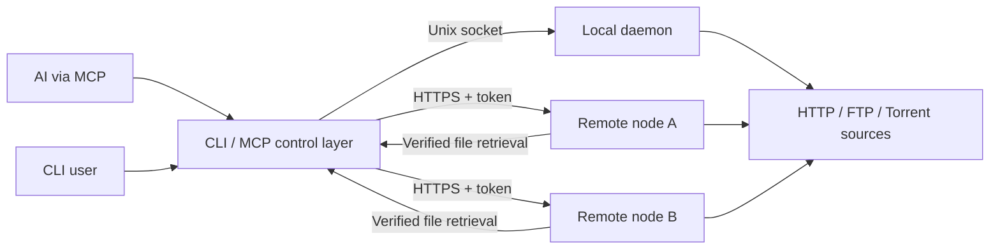

# Fetchra architecture

Fetchra is a Linux, single-user daemon. The daemon owns protocol clients and
task files. CLI and stdio MCP processes connect through JSON-RPC 2.0 over a
private Unix socket, or optional authenticated HTTPS to a remote node. They have no ownership over a transfer's lifetime.



## Ownership

- `internal/model`: public protocol-independent types and stable domain errors.
- `internal/store`: bbolt task intents, request keys, policy and ordered events.
- `internal/service`: one control loop serializes task mutations and scheduling.
  Protocol workers perform slow I/O and send bounded progress messages back.
- `internal/engine`: protocol implementations, shared limiters and confined file
  operations. Cancelling a worker implements pause; starting it implements
  recovery. This intentionally small interface avoids library types in the API.
- `internal/transport`: JSON-RPC, authenticated optional remote listener, confined
  file export, resumable client fetch and MCP adapter.
- `internal/control`: shared CLI/MCP routing, node health checks and durable
  request-key assignments. Each node remains an independent daemon.
- `cmd/fetchra`: daemon lifecycle, CLI flags and private credential loading.

Engines expose Probe, Download and Close. Download performs recovery before
transferring and pushes snapshots via Report. A context cancellation stops
transport. A task remains busy until the worker has exited, even if pause has
already been accepted. Selection, restart and removal require an idle worker.

## States and persistence

`probing -> ready -> queued -> checking/downloading -> completed`, with `paused`
and `failed`. Desired state records caller intent independently of observed
state. Completed-file readiness is revoked and checked again after restart.
Torrent hashing is the source of truth; saved percentages are not trusted.

bbolt transactions persist tasks and their events together, including removal.
A mutation is installed in memory only after its intent commits; pause cancels
the worker after that commit. Background persistence failures stop transfers and
revoke readiness instead of reporting an uncommitted success. Creation also
persists idempotency keys in the same transaction. A restart reconstructs workers
from intent. High-frequency progress stays in memory. Checkpoints contain only
data that has been written and synced. HTTP/FTP block checksums detect local
corruption; they are not proof of authenticity of the remote file.

Torrent files use an os.Root-backed storage adapter, so every piece read and
write is confined, including symlink resolution. Piece completion is volatile;
selected pieces are rehashed on every recovery. HTTP/FTP use a temporary file,
then atomically hard-link it to an available output name and persist completion.
Published files never overwrite existing paths. A crash between publication and
checkpoint commit is handled by recognizing the existing inode on recovery.

## Scheduling

Three download/checking slots and two metadata slots by default. Priority is
non-preemptive; FIFO breaks equal priorities. Seeders use idle download slots
and yield to queued downloads. HTTP segment requests also acquire a per-origin
quota shared across tasks. Protocols share token-bucket payload rate limiters.

Transient downloads have one retry layer, at most five attempts with exponential
backoff. Both daemon jobs and client fetches use it; every retry recovers synced
blocks. Probe failures can be retried explicitly.

HTTP blocks are 8 MiB, with up to four workers for files >=16 MiB. Probe uses a
real range response rather than trusting Accept-Ranges. Range requests require
a strong ETag, known length and correct 206/Content-Range. A 200 response to a
conditional range is never appended. Other sources use a single stream and do
not automatically reuse unvalidated partial content across sessions.

FTP is passive binary single-file download. REST, SIZE and modification time
enable metadata-based resume; changes stop recovery. FTP identifiers are weaker
than content hashes, and that distinction is exposed to clients.

## Local RPC

POST `/rpc` on the Unix socket, permissions 0600:

```json
{"jsonrpc":"2.0","id":1,"method":"task_add","params":{"source":"https://example.org/file","request_key":"stable","start":false}}
```

Success uses the standard `result`. Domain failures use JSON-RPC error code
-32000 and an `error.data` object with `code`, `message`, and `retryable`.
Invalid arguments use -32602; unknown methods use -32601.

CLI and MCP expose an identical envelope: `{ "result": ... }` or
`{ "error": { "code": ..., "message": ..., "retryable": ... } }`.

The service exposes these methods:

| Method | Parameters |
| --- | --- |
| task_add | source, optional credential_ref/request_key/start/sha256/filename |
| task_get | task_id |
| task_list | optional state/offset/limit |
| task_files | task_id, optional offset/limit |
| task_select | task_id, files=[{index, priority}], optional expected_revision |
| task_policy_set | task_id, policy={priority,connections,seed}, optional expected_revision |
| task_start / task_pause / task_resume / task_restart / task_remove | task_id, optional expected_revision |
| task_wait | task_id, optional condition/file_indices/timeout_seconds |
| events_list | optional task_id/cursor/limit |
| policy_get / service_status | no parameters |
| policy_set | resource_policy={active_downloads,active_probes,http_per_host,download_rate,upload_rate} |

Client tools additionally expose `task_fetch(task_id, file_index=0)` and
`node_list()`. `node` can select a configured node on other tools. `task_add`
accepts base64 `torrent_data` instead of a source path. These client operations
use the same task RPC on each node; fetch writes into the operator-configured
local fetch root.

Policies are complete replacements. Unsupported protocol-specific operations
return UNSUPPORTED_CAPABILITY. Add keys are durable and conflicts are explicit.
Torrent identity deduplicates by info hash, including magnet vs .torrent.
HTTP/FTP require caller-provided keys for deduplication rather than conflating
different authenticated representations at the same URL.

Wait conditions are metadata, completed, files, or idle, bounded to 1..30 seconds.
Tasks return at most ten preview files; lists omit previews. Full files and events
are paginated, 50 entries by default, maximum 200. Important events retain a
10,000-entry window with explicit cursor expiration.

## Compatibility and limits

The Go module is `github.com/RyanChen-cn/fetchra`; the executable is `fetchra`.
Existing bencode/tracker experiments are replaced by the mature library;
their history remains in Git. v2/hybrid torrents, FTPS/SFTP, FTP recursive trees,
cross-node file striping, automatic task migration, arbitrary post-download
commands and a GUI are outside this release. Optional task routing across
independent nodes is supported.

Go 1.25 is the minimum supported version. The download root should remain stable across restarts.
The Makefile consistently uses `-tags nosqlite`; the unused optional SQLite
adapter is excluded from official binaries and release dependency inventories.
File permissions and a private local socket implement single-user access;
remote listeners are opt-in and use a private bearer token. Non-loopback
listeners require TLS, and clients verify certificates. HTTP is limited to
loopback, for local access or encrypted SSH tunnels. See [remote.md](remote.md).

## File retrieval and node ownership

`GET`/`HEAD /files/TASK_ID/INDEX` exposes only ready files resolved within the
service's download root and task root. The server supplies a SHA-256 ETag and
uses Go's [ServeContent](https://pkg.go.dev/net/http#ServeContent) for conditional
single-range responses. Download completion records the SHA-256 and file
mtime. An unchanged ready file does not require a new full hash scan before
headers can be returned; an observed change requires explicit reverification.
These internal stamps are persisted but omitted from public snapshots. Client
fetches always check the final SHA-256. File exports share the upload limiter
with Torrent payloads; flushing and rate-aware read sizes preserve progress
at low rates. Older records can populate a bounded
256-entry stat/hash cache outside the control loop.

A fetch locks its local checkpoint across processes, uses the existing HTTP
engine and publishes without replacing existing output. It is a client transfer,
so its cancellation does not alter the node's durable download task.

A pool is a static list of named endpoints. Automatic assignment samples node
health concurrently, compares normalized running/queued load (probe load for
inspect-only adds), and uses a request-key hash to break ties. The chosen node,
endpoint and request fingerprint are committed in a separate local bbolt file
before dispatch. Concurrent callers sharing this state converge on one owner.
An ambiguous response or unavailable owner never triggers rerouting. A removed
or retargeted owner produces NODE_CONFIG_CHANGED. Subsequent calls route by
`NODE:TASK_ID`; list, policy and event operations require a node selection.

There is no shared scheduler or shared filesystem across nodes. This keeps task
recovery local and avoids introducing consensus or cross-node partial ownership.
